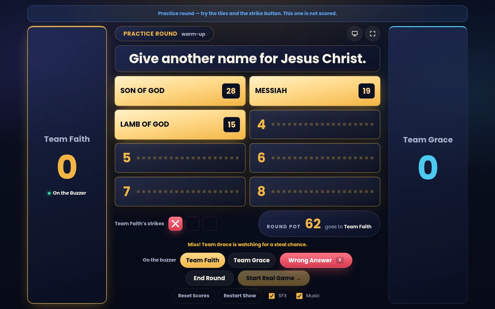
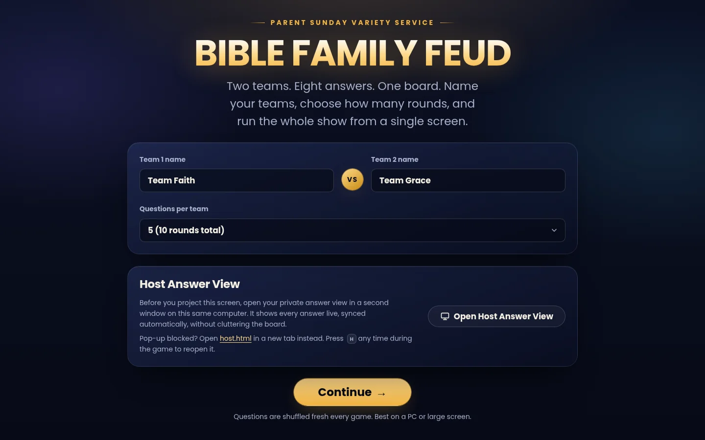

<div align="center">


# Bible Family Feud

**A stage-ready Family Feud game for church events, played entirely in the browser.**

[](https://github.com/rccgkd/bible-family-feud/actions/workflows/deploy.yml)
[](https://github.com/rccgkd/bible-family-feud/actions/workflows/codeql.yml)

[Play it live](https://rccgkd.github.io/bible-family-feud/) · [Documentation](docs/) · [Report an issue](https://github.com/rccgkd/bible-family-feud/issues/new/choose)

</div>



## About

Bible Family Feud is a free, Family Feud–style quiz built for the Parent Sunday Variety Service. Two teams take turns guessing the most popular answers to Bible questions while a host flips tiles, calls strikes and runs the show from a single screen. There is nothing to install, no account to create, and no server involved.

## Features

- 60 original Bible questions, each with eight ranked answers, plus an unscored practice round
- Name your own teams and choose 3 to 30 questions per team; rounds are reshuffled every game
- Full-screen "get ready" announcements with a countdown before every turn
- Automatic strike, steal and pot-banking rules, so the host only flips tiles and calls misses
- Private **Host Answer View** in a second window that shows every answer live and prints as a backup sheet
- Synthesized background music and sound effects, each with its own switch
- Keyboard shortcuts for the host: `1`–`8` flip tiles, `X` strike, `N` next round, `H` host view
- Works on a projector, laptop or phone, and keeps working offline once it has loaded
- Keyboard accessible, with visible focus states, and respects reduced-motion settings

## How to use it

1. Open the [live site](https://rccgkd.github.io/bible-family-feud/) on the screen you will project.
2. Enter the two team names and choose how many questions each team will answer.
3. Click **Open Host Answer View** to open your private answer key in a second window, then click **Continue**.
4. Read the rules, play the practice round, then start the real game.
5. For each guess, flip the matching tile, or press **Wrong Answer** for a miss. After three strikes the other team gets a steal attempt.
6. After the last round the final scores and winner appear.



The Host Answer View syncs with the game through your browser, so both windows need to be open in the **same browser on the same computer**. To use a second device, print the sheet from the Host Answer View before the show.

## Tech stack

- Plain HTML, CSS and JavaScript, with no framework and no runtime dependencies
- `BroadcastChannel` API for the two-window host sync
- Web Audio API for synthesized music and effects
- A service worker and web app manifest for offline use and installability
- GitHub Actions and GitHub Pages for building, checking and hosting

## Project structure

```text
.
├── index.html            Game screens
├── host.html             Private host answer view
├── 404.html              Not-found page
├── css/                  Design tokens and styles
├── js/
│   ├── questions.js      The question bank
│   ├── app.js            Game logic
│   ├── host.js           Host view
│   └── register-sw.js    Offline support registration
├── assets/               Icons, logo and social preview image
├── sw.js                 Service worker
├── scripts/              Build and quality-check scripts used by GitHub Actions
├── docs/                 Deployment and customization guides
└── .github/              Workflows, Dependabot and issue templates
```

## Documentation

- [Deployment guide](docs/DEPLOYMENT.md): how the site is published, updated and rolled back
- [Customizing guide](docs/CUSTOMIZING.md): where to change colors, text, questions, fonts and images

## Contributing

Found a bug or have an idea? [Open an issue](https://github.com/rccgkd/bible-family-feud/issues/new/choose) on GitHub. To propose a change, edit a file on GitHub and choose **Propose changes** to open a pull request. See [CONTRIBUTING.md](CONTRIBUTING.md) for details, including how to add or fix questions.

## Security

Please report vulnerabilities privately as described in [SECURITY.md](SECURITY.md).

## Credits

- Typefaces: [Archivo](https://fonts.google.com/specimen/Archivo) and [Inter](https://fonts.google.com/specimen/Inter), served by Google Fonts under the SIL Open Font License
- Questions, answers and artwork are original to this project
